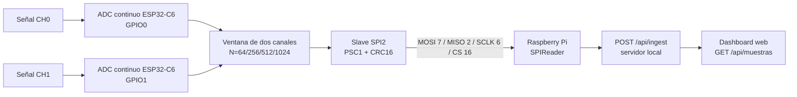
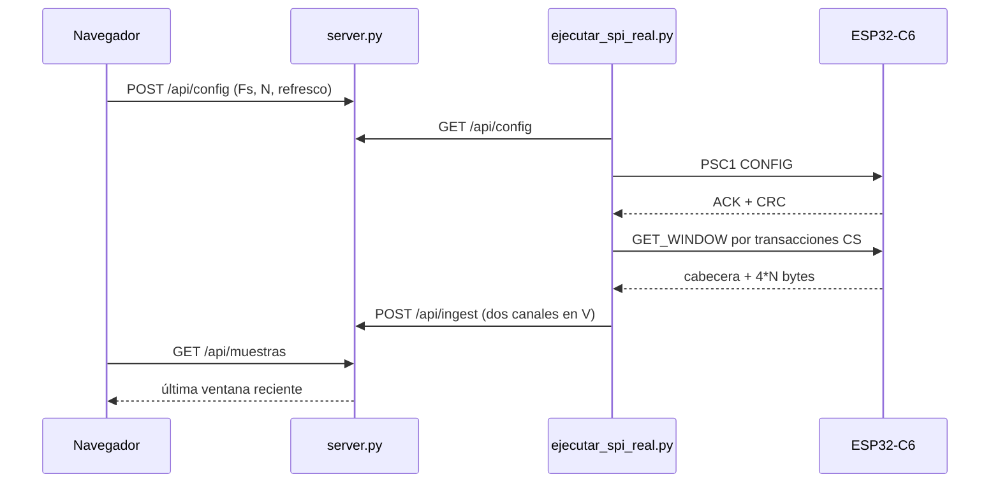

# Arquitectura integrada

## Alcance y evidencia

La fuente activa está en `firmware/` y `dashboard/`. La arquitectura siguiente describe el código presente, no una integración física ya demostrada. Las pruebas automatizadas cubren Python, API, emulación y protocolo PSC1 con transporte falso; no cubren placa, cableado, ADC, HTTP sobre una Pi ni end-to-end físico.

## Componentes

El lector real realiza transacciones CS independientes, divide respuestas en chunks de hasta `2048` bytes y no depende de una línea READY. El adaptador real está en `dashboard/real/raspberry/ejecutar_spi_real.py`; la plantilla `adaptador_spi_plantilla.py` no implementa SPI.

## Flujo de configuración y adquisición

En modo `simulation`, `server.py` genera datos artificiales. En modo `external`, sólo muestra una ventana recibida por HTTP y devuelve 503 si no existe una ventana reciente o no coincide con la configuración. Ninguna de esas rutas simula una captura física.

## Contratos observables

- Tasas aceptadas por el código: `100`, `1000`, `10000` y `40000` Sa/s; `40000` es experimental y no está presentado como medición.
- Ventanas: `64`, `256`, `512` y `1024` muestras por canal.
- El firmware usa PSC1, mode 0, CRC16-CCITT y respuestas de `20 + 4*N` bytes para `GET_WINDOW`.
- El ADC se configura como continuo, dos canales de ADC1, 12 bits y atenuación de 12 dB.
- Una ventana de 1024 muestras a 100 Sa/s tarda como mínimo 10.24 s; un refresh de 1–4 s consulta la última ventana, no crea una nueva medición completa.

## Límites y pendientes

No se declara compilación verificada aquí sin ejecutar ESP-IDF, ni conexión eléctrica, frecuencia efectiva, calidad de ADC, captura de analizador, despliegue de servicios o integración completa. Los resultados de tests deben citarse como software local. El vídeo y los chats completos/redactados permanecen pendientes en [`../entregables/`](../entregables/); su ausencia no se rellena con capturas inventadas.

La documentación histórica no reconciliada y otras referencias heredadas se tratarán en U3; este cambio sólo corrige las rutas de los documentos permitidos.
